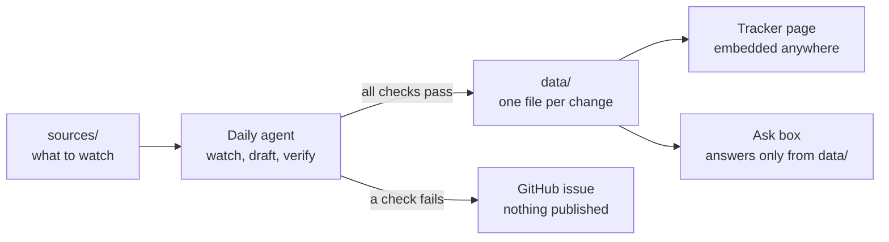

# Regulation tracker

A public page where law firms see what has changed in legal regulation, for one country at a time (UK or Australia). A daily AI agent keeps it current. Nobody needs to touch it day to day.

The page design is in `mockup/index.html`.

## How it works



There are three parts, and the repo is the database.

1. **`sources/`** lists what the agent watches: official regulators, government and published law only.
2. **`data/`** holds one JSON file per change. Git history is the audit trail: every edit is dated and can be reversed.
3. **`agent/`** holds the daily agent and its rules (`agent/instructions.md`).

## The daily run

The agent runs every morning on GitHub's scheduler.

1. **Watch.** It checks every source in `sources/` and keeps only what is new or different since the last run.
2. **Draft.** For each new item, AI either writes a new record or updates the existing one (for example, a consultation that has become a final rule).
3. **Verify.** A second, independent AI pass checks every field against the source text: dates, stage and who it applies to. Code checks run as well:
   - the record matches the format;
   - the source link works;
   - the dates are real;
   - nothing is marked "in force" with a future date.
4. **Publish or stop.**
   - If every check passes, the agent commits the record and the page updates.
   - If any check fails, nothing is published and the agent opens a GitHub issue explaining why.

Once a week it also re-reads the source for every proposed or decided change, so stages and dates stay current.

## One record

```json
{
  "id": "uk-sra-client-money-reports",
  "country": "uk",
  "regulator": "SRA",
  "title": "Annual accountants' reports for every firm holding client money",
  "summary": "Every firm that holds client money will file an accountants' report each year.",
  "what_changes": ["An accountants' report and firm declaration every year."],
  "applies_to": ["money"],
  "who_it_applies_to": "All SRA-regulated firms that hold client money.",
  "topic": "Client money",
  "stage": "decided",
  "dates": { "proposed": "2024-11", "decided": "2026-07-31", "in_force": "2027-01" },
  "source": { "name": "SRA", "url": "https://www.sra.org.uk/news/news/press/safeguards-protect-client-money" },
  "last_checked": "2026-10-15",
  "history": [
    { "date": "2026-07-31", "event": "Legal Services Board approved the rules. Stage moved to decided." }
  ]
}
```

- **Stages:** `proposed`, then `decided`, then `in_force`. Guidance from a regulator uses `guidance`.
- **Dates:** a date can be a full day (`2026-07-31`) or just a month (`2027-01`) when the regulator has only given a month.
- **`applies_to`:** uses fixed keys for what a firm does, so the page can filter by them. They are listed in `agent/instructions.md`.

## The ask box

When someone asks a question, the page sends it to a small function, along with that country's records. AI answers only from those records and must cite them. Any sentence without a citation is dropped. At this size (hundreds of records) no search database is needed.

## Hosting

- **The page:** a static site, embeddable anywhere with one line.
- **The ask box:** one small serverless function that holds the AI key. A Cloudflare Worker fits, since Legl already runs Workers.

## To switch it on

- An Anthropic API key, stored as a GitHub secret (for the agent) and in the Worker (for the ask box).
- A Cloudflare Pages project for the page.
